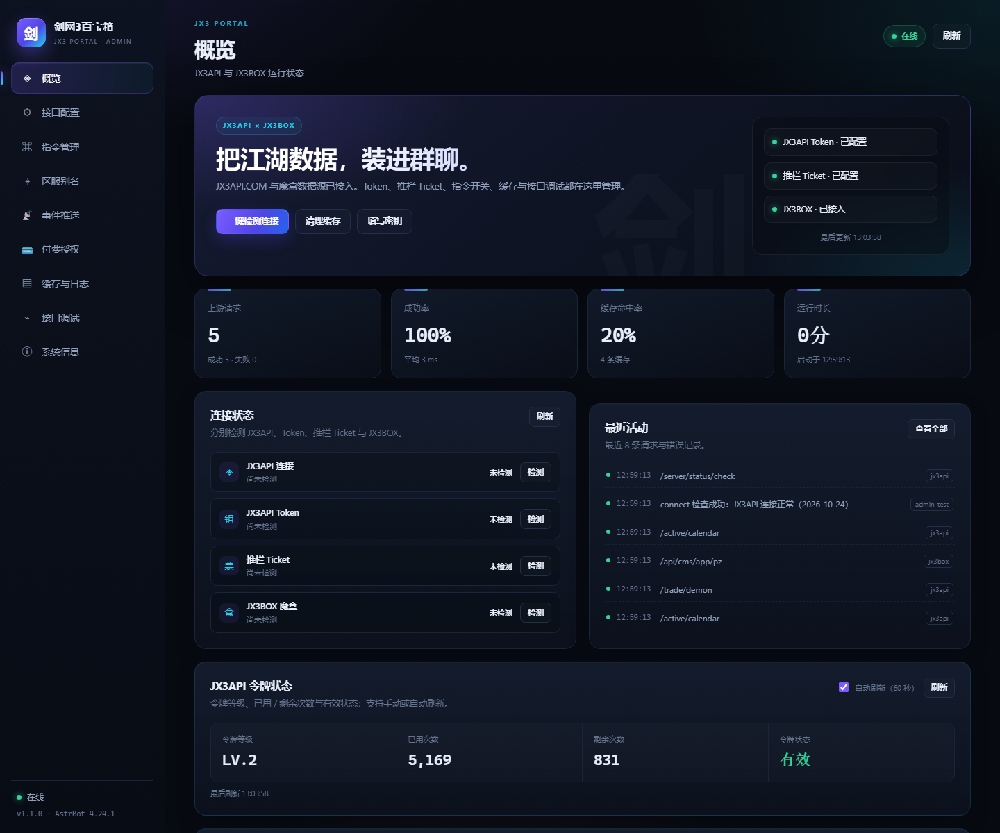
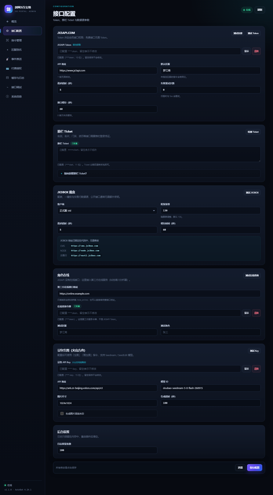
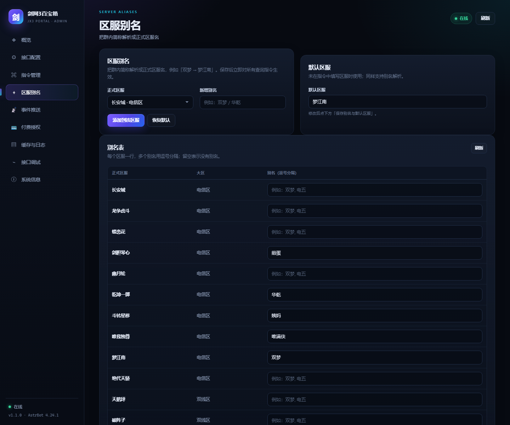
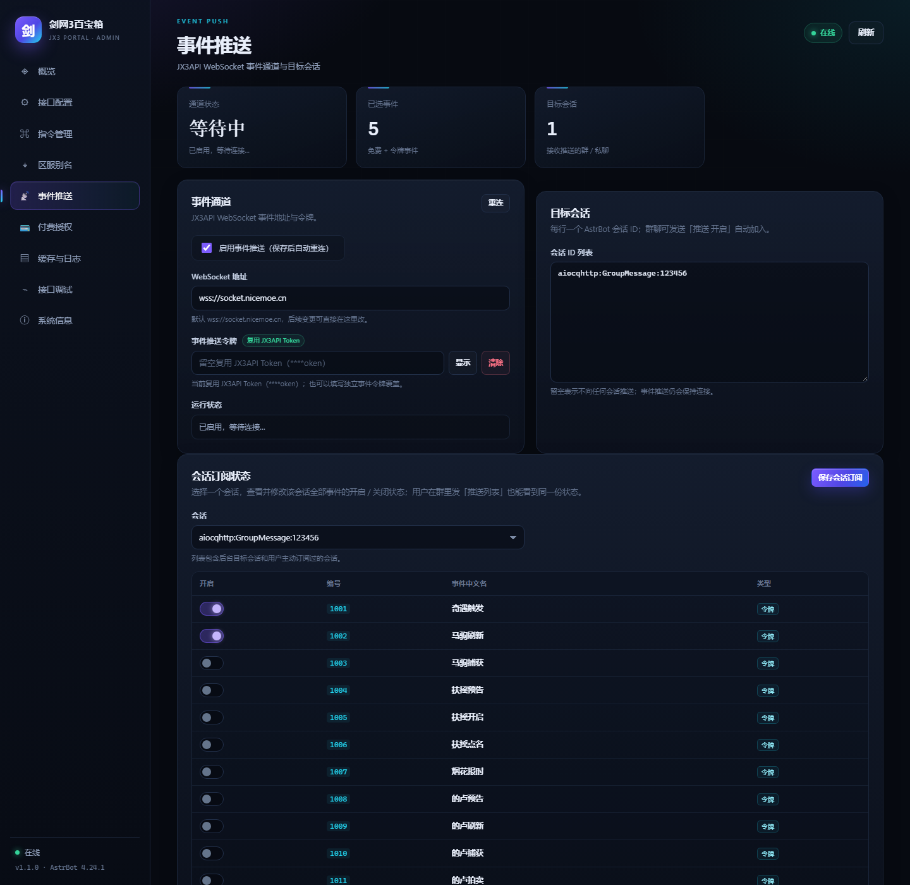
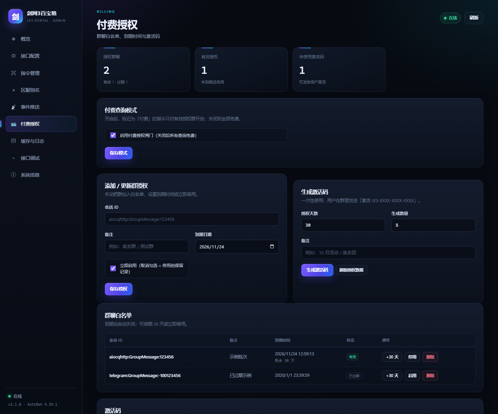
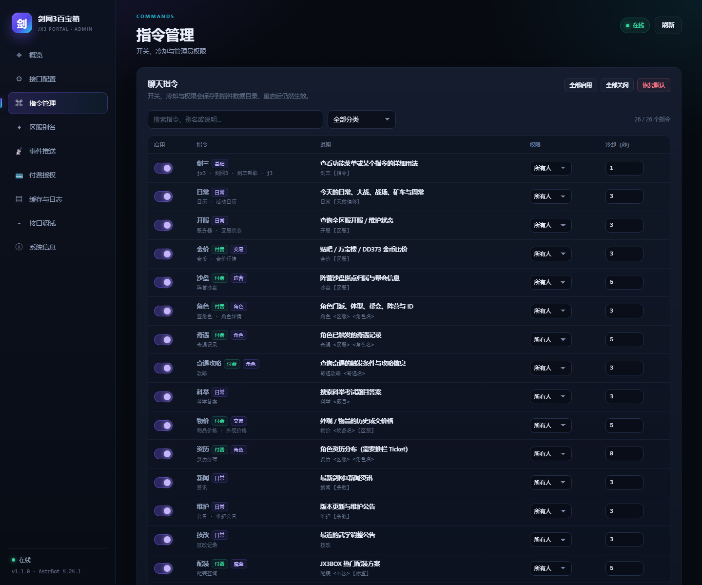
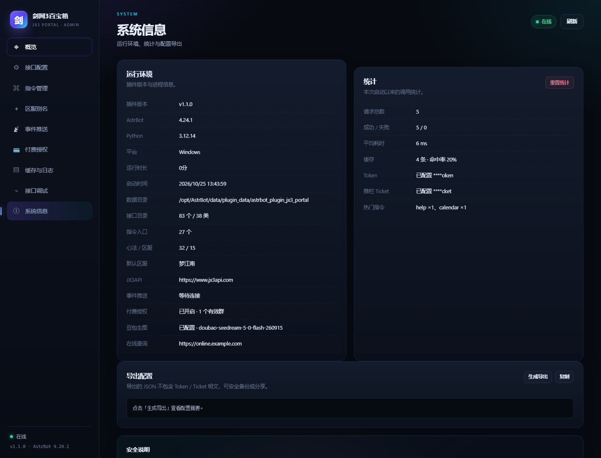

# 剑网3百宝箱 · astrbot_plugin_jx3_portal

> 接入 **JX3API.COM** 与 **JX3BOX 魔盒** 的 AstrBot 插件。  
> **27 个聊天指令**、83 个 JX3API 接口目录、推栏 Ticket、事件 WebSocket 推送、角色在线、付费授权 / 激活码、豆包生图，以及 9 页可视化后台。



## 功能一览

### 查询能力

| 数据源 | 内容 |
| --- | --- |
| JX3API.COM | 日常日历、区服开服、金价、沙盘、角色、奇遇、奇遇攻略、科举、物价、资历、新闻、维护公告、技改 |
| JX3BOX 魔盒 | 配装方案、一键宏、交易行成交价 |
| 推栏 Ticket | 名剑 / 名片 / 门派 / 资历等需要推栏登录态的 JX3API 接口 |
| 第三方在线服务 | 角色在线 / 离线（JX3API 没有在线接口） |
| 豆包（火山方舟） | 文生图、图生图 |

- **按接口等级自动鉴权**：LV.0 免费接口不附带 Token；LV.1 / LV.2 自动附带 Token；标记 `[需ticket]` 的接口自动附带推栏 Ticket。
- **JX3BOX 地址固定**：`cms.jx3box.com` / `next2.jx3box.com` 写在代码里，后台不再暴露地址输入框。
- **缓存与重试**：JX3API / JX3BOX 分别配置 TTL；超时与 5xx 自动重试；429 单独提示。
- **错误可读**：401、403（Ticket 过期 / 等级不足）、404、429 都会翻译成能直接处理的中文提示。
- **文本 + 图片**：普通查询默认纯文本并按 1800 字分片；`剑三` / `功能`、`日常 图`、`沙盘 图`、`物价`、`奇遇 图` 会渲染图片，豆包生图返回图片消息。

### 新增能力

**事件推送**

- 事件通道地址默认 `wss://socket.nicemoe.cn`，后台可改。
- 事件令牌留空时**自动复用 JX3API Token**，也可以填独立令牌。
- 内置 39 个 JX3API 事件（免费 2001~2006 + 令牌事件 1001~1122），后台勾选、目标会话列表、一键重连。
- 群成员可以发送「事件推送 开启 / 关闭 / 列表」自助订阅。
- 付费授权开启时，令牌事件只推送给授权有效的群；免费事件不受限制。

**角色在线**

- 后台「接口配置 → 角色在线」填写第三方在线服务地址和令牌。
- 只填域名自动拼 `/role_online`，也可以填完整接口地址。
- 先经 JX3API `/role/detail` 取区服 / role_id / global_role_id，再请求第三方 `gameLogin` 字段；只接受明确在线证据，避免把名片展示误判为在线。

**付费授权**

- 后台添加群聊白名单、到期日期、备注；支持立即停用、续期 30 天、删除。
- 批量生成一次性激活码（天数 + 数量 + 备注）；群里发送 `激活 JX3-XXXX-XXXX-XXXX` 即绑定当前会话并顺延到期时间。
- 开启付费闸门后，标记为「付费」的指令只对有效授权群开放；关闭后全部免费。
- 到期 / 停用 / 未开通分别返回不同的中文提示。

**豆包生图**

- 后台填写火山方舟 API Key、Base URL、模型、尺寸、水印、超时。
- 指令：`生图 <提示词>`、`图生图 <图片URL> <提示词>`。
- 支持 Seedream / SeedEdit 模型；生成图保存到插件数据目录并直接发到聊天。

### 后台管理（9 个页面）

| 页面 | 能力 |
| --- | --- |
| 概览 | 请求数、成功率、缓存命中率、运行时长、连接状态、JX3API 令牌状态（等级 / 已用 / 剩余 / 有效，手动 + 60 秒自动刷新）、最近活动、快速开始 |
| 接口配置 | JX3API Token / 地址 / 超时 / 重试 / 缓存、默认区服、推栏 Ticket、JX3BOX 固定地址、角色在线、豆包生图、日志条数 |
| 指令管理 | 27 个指令的启用开关、冷却时间、所有人 / 管理员权限；付费指令标记 |
| 区服别名 | 双梦 / 华乾等简称映射到正式区服，修改后所有查询生效；默认区服 |
| 事件推送 | 通道开关、WebSocket 地址、令牌、39 个事件（中文名 + 对应接口）、目标会话、会话订阅状态、连接状态、重连 |
| 付费授权 | 付费模式开关、群聊白名单、到期时间、续期 / 停用 / 删除、激活码生成与复制 |
| 缓存与日志 | 缓存分区统计、按 JX3API / JX3BOX 清理、请求日志筛选与清空 |
| 接口调试 | 83 个接口的目录搜索、参数表单、在线发送、JSON 响应查看与复制 |
| 系统信息 | 版本、Python、AstrBot、数据目录、统计、导出脱敏配置 |













后台不会把 Token / Ticket / API Key 明文发送到前端：保存后只显示 `****abcd` 掩码，输入框留空保存表示不修改，清除密钥是独立操作。

## 安装

1. 将 `astrbot_plugin_jx3_portal` 整个文件夹放入 AstrBot 的插件目录：
   ```text
   AstrBot/
     data/
       plugins/
         astrbot_plugin_jx3_portal/
           main.py
           metadata.yaml
           ...
   ```
   也可以直接上传发布包 `astrbot_plugin_jx3_portal.zip`（压缩包内已包含顶层目录）。
2. 重启 AstrBot，或在 WebUI 插件页重载插件。
3. 打开 **插件 → 剑网3百宝箱 → 可视化视图**，按「快速开始」填写：
   - JX3API Token（[jx3api.com](https://www.jx3api.com) 获取）；
   - 推栏 Ticket（需要名剑 / 名片 / 门派 / 资历时填写，见 [推栏 Ticket](docs/TUILAN.md)）。请粘贴推栏 Cookie / 登录请求里 `ticket=` 后面的原始值，不要手动 URL 解码；插件会保留原值并调用 `/school/matrix` 检测；
   - 默认区服（例如 `梦江南`）。
4. 点击「一键检测连接」，确认 JX3API、Token、Ticket、JX3BOX 四项正常。
5. 在群里发送 `剑三`，即可看到功能菜单。

> 测试按钮会先保存当前表单再检测，因此粘贴新 Token 后可以直接点「测试 Token」，不用先手动保存。

> 如果群聊没有反应，请检查 AstrBot 的唤醒方式 / 指令前缀设置。本插件通过一个 `event_message_type(ALL)` 监听器解析消息，不依赖逐个 `@filter.command` 注册。

## 指令

| 指令 | 别名 | 用法 | 说明 | 付费 |
| --- | --- | --- | --- | --- |
| 剑三 | jx3、剑网3、剑三帮助、j3 | `剑三 [指令]` | 功能菜单 / 单条指令用法 | 免费 |
| 日常 | 日历、活动日历 | `日常 [天数偏移\|本周] [图]` | 大战、战场、矿车、周常、福缘；加「图」生成日历图片 | 免费 |
| 开服 | 服务器、区服状态 | `开服 [区服]` | 全区服开服 / 维护状态 | 免费 |
| 科举 | 科举答案 | `科举 <题目>` | 科举题库搜索 | 免费 |
| 新闻 | 资讯 | `新闻 [条数]` | 最新新闻 | 免费 |
| 更新 | 维护、公告、维护公告、更新公告、游戏更新 | `更新 [条数]` | 最新版本更新正文图，或最近几条公告 | 免费 |
| 技改 | 技改记录 | `技改` | 武学调整公告 | 免费 |
| 心法 | 门派 | `心法 [关键词]` | 支持的心法 / 别名 | 免费 |
| 推栏 | tuilan | `推栏 [检测\|帮助]` | Ticket 状态、检测、抓包教程 | 免费 |
| 激活 | 激活码、redeem | `激活 <激活码>` | 开通 / 续期本群付费授权 | 免费 |
| 付费状态 | 授权状态、付费 | `付费状态` | 查看本群到期时间 | 免费 |
| 事件推送 | 推送 | `推送 <事件名> 开启\|关闭`；`推送 开启\|关闭` | 按事件名管理本群订阅；不带事件名则切换本群总开关 | 免费 |
| 推送列表 | 推送状态、事件列表 | `推送列表` | 查看本群全部事件的开启 / 关闭状态 | 免费 |
| 剑三诊断 | 插件诊断、jx3诊断 | `剑三诊断` | Token / Ticket / JX3BOX / 缓存 / 事件 / 授权自检 | 管理员 |
| 金价 | 金币、金价行情 | `金价 [区服]` | 贴吧 / 万宝楼 / DD373 比价 | 付费 |
| 沙盘 | 阵营沙盘 | `沙盘 [区服] [图]` | 据点归属、帮会、帮主；加「图」生成沙盘图 | 付费 |
| 角色 | 查角色、角色详情 | `角色 <区服> <角色名>` | 门派、体型、帮会、阵营、ID | 付费 |
| 在线 | 角色在线、查在线 | `在线 <区服> <角色名>` | 第三方在线接口查询 | 付费 |
| 奇遇 | 奇遇记录 | `奇遇 <区服> <角色名> [图]` | 角色已触发奇遇；加「图」生成水墨奇遇卡 | 付费 |
| 奇遇攻略 | 攻略 | `奇遇攻略 <奇遇名>` | 触发条件 / 攻略信息 | 付费 |
| 物价 | 物品价格、外观价格 | `物价 <物品名> [区服]` | 万宝楼公示 / 在售、玩家交易和价格走势图 | 付费 |
| 资历 | 资历分布 | `资历 <区服> <角色名>` | 资历分布（需 Ticket） | 付费 |
| 配装 | 配装查询 | `配装 <心法> [标签]` | JX3BOX 配装方案 | 付费 |
| 宏 | 一键宏 | `宏 <心法>` | JX3BOX 一键宏 | 付费 |
| 交易行 | 拍卖行 | `交易行 <物品> [区服]` | JX3BOX 交易行成交价 | 付费 |
| 生图 | 绘图、画图 | `生图 <提示词>` | 豆包 AI 文生图 | 付费 |
| 图生图 | 垫图 | `图生图 <图片URL> <提示词>` | 豆包 AI 图生图 | 付费 |

示例：

```text
角色 梦江南 张三
在线 梦江南 张三
奇遇 梦江南 张三
配装 花间 PvE
宏 奶花
交易行 五行石 梦江南
推栏 检测
激活 JX3-ABCD-EFGH-JKLM
事件推送 开启
生图 剑网3 水墨 花间 成女
```

- 未填写区服时使用后台的「默认区服」；也可以每个指令单独传区服。
- 所有指令的冷却、启用状态和管理员权限都可以在后台调整。
- 「付费」只是付费闸门开启时的限制；关闭付费模式后所有指令免费。

## 配置项

后台可视化页面和 AstrBot 插件配置页使用同一份配置，修改任意一处都会生效。

| 配置键 | 默认值 | 说明 |
| --- | --- | --- |
| `jx3api_token` | 空 | JX3API 访问令牌，LV.1 / LV.2 接口与事件推送需要 |
| `jx3api_ticket` | 空 | 推栏 Ticket，名剑 / 名片 / 门派 / 资历接口需要 |
| `jx3api_base_url` | `https://www.jx3api.com` | JX3API 地址 |
| `jx3api_timeout` | `20` | 请求超时（秒） |
| `jx3api_retries` | `1` | 失败重试次数（仅超时 / 5xx） |
| `jx3api_cache_ttl` | `60` | JX3API 缓存秒数，0 关闭 |
| `default_server` | 空 | 默认区服 |
| `jx3box_timeout` | `25` | JX3BOX 超时（秒） |
| `jx3box_cache_ttl` | `300` | JX3BOX 缓存秒数 |
| `jx3box_client` | `std` | `std` 正式服 / `origin` 缘起服 |
| `jx3box_global_level` | `130` | 配装筛选装等，随赛季调整 |
| `online_api_url` | 空 | 第三方角色在线服务地址 |
| `online_api_token` | 空 | 第三方在线服务令牌（不是 JX3API Token） |
| `event_push_enabled` | `false` | 启用事件 WebSocket |
| `event_push_wss_url` | `wss://socket.nicemoe.cn` | 事件通道地址，可改 |
| `event_push_token` | 空 | 事件令牌；留空复用 JX3API Token |
| `event_push_actions` | `[2001..2006]` | 推送事件编号 |
| `event_push_sessions` | `[]` | 目标 AstrBot 会话 ID |
| `paid_enabled` | `false` | 启用付费查询闸门 |
| `doubao_api_key` | 空 | 火山方舟 API Key |
| `doubao_base_url` | `https://ark.cn-beijing.volces.com/api/v3` | 豆包 API 地址 |
| `doubao_model` | `doubao-seedream-5-0-flash-260915` | 生图模型 |
| `doubao_size` | `1024x1024` | 图片尺寸 |
| `doubao_watermark` | `false` | 是否加水印 |
| `doubao_timeout` | `180` | 生成超时（秒） |
| `admin_log_limit` | `300` | 内存日志保留条数 |

> JX3BOX 的 CMS / NODE / 交易行地址固定在代码中；后台只保留客户端、装等、超时、缓存设置。

> 密钥以 AstrBot 配置的存储方式保存在 `config.json` 中（明文），请保护好服务器文件权限。后台页面只显示掩码。

## 付费授权流程

1. 后台「付费授权」开启「付费查询闸门」。
2. 在「添加 / 更新群授权」填会话 ID、到期日期，或直接生成激活码。
3. 把激活码发给群管理员 / 用户，群里发送：
   ```text
   激活 JX3-ABCD-EFGH-JKLM
   ```
4. 机器人把当前会话写入白名单，到期时间 = 当前时间 + 激活码天数；已有授权会在原到期时间上顺延。
5. 到期后付费指令返回“已到期”，管理员可在后台续期 30 天或重新激活。
6. 关闭「付费查询闸门」后，所有指令立即免费（白名单和激活码记录保留）。

会话 ID 可以在群里发送「付费状态」或「事件推送 状态」查看，格式类似 `aiocqhttp:GroupMessage:123456`。

## 事件推送流程

1. 后台「事件推送」勾选事件、填写目标会话，打开「启用事件推送」。
2. 保存后自动重连；状态显示“已连接”即成功。
3. 群成员也可以发送「事件推送 开启」把当前会话加入目标列表。
4. 令牌事件在付费闸门开启时只发给有效授权群；免费事件 2001~2006 不受限制。
5. 事件目录和字段排版见 [事件推送说明](docs/EVENT_PUSH.md)。

## 区服别名与令牌状态

- 后台「区服别名」把群内简称映射到正式区服，例如 `双梦 → 梦江南`、`华乾 → 乾坤一掷`。保存后立即对所有指令生效；默认区服也支持别名。
- 别名数据保存在插件数据目录的 `server_aliases.json`，首次运行从随包种子复制；可随时恢复默认。
- 概览页新增「JX3API 令牌状态」卡片：令牌等级、已用次数、剩余次数、有效状态，支持手动刷新和 60 秒自动刷新。
- 复制/粘贴 Token 后直接点「测试 Token」即可，测试会先保存当前表单。

## 图片模板与素材

- `templates/pages/`：62 个功能展示页（日常、沙盘、奇遇、金价、资历、成就、团队等）。
- `templates/sect/`：56 张心法 / 门派图片。
- `templates/serendipity/`：129 张奇遇图片。
- `templates/img/`、`templates/styles/`、`templates/layouts/`：沙盘图标、页面 CSS 与基础布局。
- 百宝箱自带 Playwright 渲染服务，使用系统 Chromium，随插件启动和关闭。默认接管本机 `127.0.0.1:8999` 的启动；已运行的服务会直接复用，外部渲染地址保持原设置。不依赖其他剑三插件。渲染通过 AstrBot 的 `html_render` 完成；`剑三` / `功能` 生成功能目录图，`日常` 生成日常日历，`沙盘 梦江南` 生成阵营沙盘，`物价 十五夜观灯 梦江南` 生成万宝楼价格图，`奇遇 梦江南 张三` 生成水墨奇遇卡。
- 其他页面的数据适配器可按同样方式继续接入；当前渲染器不依赖 AstrBot 也能做 HTML 组装，缺少 `html_render` 时会自动回退文字。

## 角色在线 / 豆包

- 在线查询协议、第三方服务约定与排障见 [角色在线](docs/ONLINE.md)。
- 豆包模型、参数、错误码与生图示例见 [豆包生图](docs/DOUBAO.md)。

## 目录结构

```text
astrbot_plugin_jx3_portal/
├─ main.py                     # @register + 功能名 command_map + ALL 监听器 + Web 路由
├─ metadata.yaml
├─ _conf_schema.json
├─ jx3portal/
│  ├─ commands.py              # 27 个 CommandSpec、付费闸门、参数解析、指令实现
│  ├─ jx3api.py                # JX3API.COM 客户端（83 接口目录 / 鉴权 / 缓存 / 错误映射）
│  ├─ jx3box.py                # JX3BOX 配装 / 宏 / 交易行（地址固定）
│  ├─ tuilan.py                # 推栏 Ticket 归一化、掩码、检测
│  ├─ aliases.py               # 区服别名（双梦 / 华乾 → 正式区服）
│  ├─ online.py                # 第三方角色在线查询
│  ├─ event_push.py            # WebSocket 事件通道、事件分发
│  ├─ event_catalog.py         # 39 个事件名称 / 字段 / 对应接口（移植自参考插件）
│  ├─ paid.py                  # 白名单、到期、激活码
│  ├─ render.py                # HTML 模板组装、素材 data URI、日常 / 奇遇图片
│  ├─ doubao.py                # 豆包生图
│  ├─ settings.py              # 配置校验、密钥掩码、指令开关
│  ├─ admin.py                 # 后台业务逻辑
│  ├─ cache.py / http.py / telemetry.py / format.py / catalog.py / assets.py
├─ data/
│  ├─ endpoints.json           # 83 个 JX3API 接口目录
│  ├─ kungfu.json              # 32 个心法 / 门派别名
│  ├─ server_aliases.json      # 区服别名种子
│  └─ servers.json             # 区服静态表
├─ views/dashboard/            # 后台页面（原生 JS，无构建步骤）
│  └─ assets/img/              # 后台预览用阵营 / 沙盘图标
├─ templates/                  # 参考插件功能页与素材
│  ├─ pages/                   # 62 个 Jinja2 功能页
│  ├─ styles/ layouts/         # 页面 CSS 与基础布局
│  ├─ sect/                    # 56 张心法 / 门派图
│  ├─ serendipity/             # 129 张奇遇图
│  └─ img/                     # 沙盘 / 阵营图标
├─ docs/                       # 接口 / 推栏 / 事件 / 在线 / 豆包 / 后台 / 开发文档
├─ tests/                      # 114 个标准库单测
├─ tools/                      # 目录生成、预览、打包脚本
├─ logo.png
└─ README.md
```

### 从消息到结果怎么执行？

`main.py` 只做三件事：

1. `@register` 声明插件、`Star` 生命周期；
2. `ini_command_map()` 维护 `{功能名: CommandSpec.key}`，并用一个 `filter.event_message_type(ALL)` 监听器解析消息；
3. `register_web_apis()` 注册后台路由。

具体的 API 参数、鉴权、缓存、格式化都在 `jx3portal/` 里。新增功能时不需要改 `main.py` 的监听器逻辑：

```python
# jx3portal/commands.py
CommandSpec("my_feature", "我的功能", ("别名",), "我的功能 <参数>", "说明", "分类")

async def _cmd_my_feature(self, args: str, event):
    return await self.api.request("/my/endpoint", {"name": args})

```

更完整的说明见 [开发文档](docs/DEVELOPMENT.md)。

## API 文档

- [JX3API 接口参考](docs/JX3API.md)：83 个接口的路径、等级、Ticket 要求、参数。
- [JX3BOX 接口说明](docs/JX3BOX.md)：配装、宏、物品库、交易行的请求 / 响应字段。
- [推栏 Ticket](docs/TUILAN.md)：获取方法、粘贴格式、检测方式、过期处理。
- [事件推送](docs/EVENT_PUSH.md)：39 个事件编号、字段、WebSocket 协议、目标会话。
- [角色在线](docs/ONLINE.md)：第三方 `/role_online` 协议与排障。
- [豆包生图](docs/DOUBAO.md)：模型、参数、错误码、示例。
- [后台管理](docs/ADMIN.md)：页面、路由、配置项、缓存命名空间、调试模式。
- [开发与测试](docs/DEVELOPMENT.md)：架构、新增指令、单测、预览、打包。

## 常见问题

**Q：后台页面打不开 / 提示没有检测到桥接？**  
A：请从 AstrBot WebUI 的插件卡片进入「可视化视图」，不要直接双击 `index.html`。需要 AstrBot 4.10+ 的插件页面支持；旧版本仍可通过插件配置页填写 Token / Ticket。

**Q：输入 Token 后测试还是失败？**  
A：测试按钮会先保存当前表单；如果仍失败，请查看具体错误：
- HTTP 401 / “Token 无效”：Token 填错、已失效，或复制时带了多余字符。
- HTTP 403 / “等级不足”：Token 等级不够（LV.1 / LV.2）。
- HTTP 403 / “Ticket”：推栏 Ticket 失效，和 Token 无关。
- 网络错误：服务器访问不了 `www.jx3api.com`，检查 DNS / 代理 / TLS。
后台「剑三诊断」会同时检查这些项，并显示最近请求日志。

**Q：返回 403 / “Ticket 过期”？**  
A：推栏 Ticket 失效。重新抓包获取，粘贴时可以直接贴整段 Cookie 或 `ticket=...`，插件会自动截取。注意 Ticket 与 Token 是两种不同的凭证。

**Q：返回 429？**  
A：请求过于频繁。调大后台的 JX3API 缓存时间，或降低指令冷却。

**Q：JX3BOX 配装为空 / 查不到？**  
A：检查「配装装等」是否与当前赛季一致；JX3BOX 地址已固定，无需填写。JX3BOX 是网站接口，赛季切换或接口调整时可能短暂失效。

**Q：事件推送一直“等待中”？**  
A：需要 AstrBot 自带的 aiohttp；检查后台状态里的 `last_error`，确认 `wss://socket.nicemoe.cn` 可访问、令牌有效。保存后点「重连」。

**Q：付费指令提示未开通？**  
A：后台开启付费闸门后，只有白名单内且未到期的会话可用。发送「付费状态」查看会话 ID，后台添加白名单，或在群里发送「激活 <激活码>」。

**Q：生图提示未配置 Key？**  
A：后台「接口配置 → 豆包生图」填写火山方舟 API Key，并确认开通了对应图片模型。详细错误见 [豆包生图](docs/DOUBAO.md)。

## 安全说明

- 后台没有独立的账号密码，访问权限由 AstrBot WebUI 的登录态保护；请勿把 AstrBot 面板暴露到公网。
- API 只返回密钥掩码，不返回明文；导出配置也不包含明文。
- 日志只记录接口路径、状态、耗时，不记录查询串，因此不会把 Token / Ticket 写进日志。
- 推栏 Ticket 等同于推栏登录态，泄露后请尽快在推栏退出登录 / 重新登录使旧 Ticket 失效。
- 激活码等同于付费授权凭证，请只发给购买者；后台可随时删除未使用激活码。

## 开发与测试

```bash
# Python 单测（114 个，零第三方依赖）
python -m unittest discover -s tests -t . -v

# 后台页面 DOM 冒烟测试（需要 Node.js + 工作区已安装 jsdom）
node tools/check_ui.mjs

# 本地预览后台（注入 mock bridge，不依赖 AstrBot）
python tools/make_preview_fixture.py
python tools/preview_server.py 8931
# 打开 http://127.0.0.1:8931/?tab=overview

# 重新生成接口目录
python tools/build_catalog.py docs/JX3API.md data/endpoints.json

# 打包
python tools/build_zip.py
```

测试覆盖：配置校验与密钥掩码、TTL 缓存、JX3API 鉴权 / 缓存 / 错误映射、JX3BOX 配装 / 宏 / 交易行、指令权限 / 冷却 / 禁用、付费授权 / 激活码 / 到期、事件格式化 / 分发 / 付费过滤、在线查询、豆包生图、后台 API 与导出脱敏。

## 版本

当前版本 `1.1.0`。更新记录见 [CHANGELOG.md](CHANGELOG.md)。

## 致谢

- [JX3API.COM](https://www.jx3api.com) 提供剑网3数据接口；
- [JX3BOX 魔盒](https://www.jx3box.com) 提供配装、宏与交易行数据；
- 事件目录、字段排版和 command map 写法参考了 `astrbot_plugin_jx3_miemie`；
- 豆包生图接口参考了火山方舟 OpenAI 兼容文档。

本项目与 JX3API、JX3BOX、西山居没有隶属关系。请遵守各数据源的使用条款，控制请求频率。


## 2026-10-26 更新使用说明

- `功能`：直接查看可用指令。未启用、未配置、无权限的功能会隐藏。
- `日常`、`沙盘 唯我独尊`、`奇遇 唯我独尊 刀剑笑我`：默认返回图片；追加 `文字` 返回文字。
- `新闻`：最近一条资讯的一张摘要图，文字取自官方正文和标题，按章节选少量代表配图。
- `新闻 全文`：主动查看完整正文分页；`新闻 5`：最近五条标题和链接。
- `更新`：主动查询最新版本更新或维护公告，直接发送正文图片；`更新 3`：最近三条公告。保留 `维护`、`公告` 等旧指令。
- `维护`：最近一次更新公告正文，长公告分页。
- `奇遇攻略 三尺青锋`：魔盒攻略正文。

推送沿用已有的目标和订阅设置。百宝箱推送关闭时，相关指令留给其他插件处理。自动新闻推送采用摘要图，维护公告采用正文图；不抓取网页广告和导航，也不播放嵌入视频。

`main.py` 负责 AstrBot 接入；`commands.py` 定义指令和参数；`jx3api.py` / `jx3box.py` 访问数据；`render.py` 整理显示数据并渲染；`articles.py` 选择新闻内容和分页。模板文件只负责排版，保留的模板不等于已实现同名指令。

## 1.1.2 架构整理

- 指令直接从 `COMMANDS` 注册；新增功能只需目录条目和 `_cmd_*` 实现。帮助、权限和配置条件共用这份目录。
- 普通查询整个流程最多等待 35 秒；生图保留配置的生成等待时间和 30 秒下载时间。
- 配置、别名和指令设置落盘失败时保留原状态；推送修改单项不会清空继承项，退订会阻止尚在渲染中的新闻发送。
- 激活码和授权以 `paid_state.json` 一次原子提交；第一次使用会读取旧的 `paid_groups.json` / `activation_codes.json`，旧文件保留。
- `jx3box_cache_ttl=0` 关闭全部魔盒缓存；后台清缓存会真正清除物品库和攻略缓存。

### 1.2.1 响应与字体

- 本机出图直接使用百宝箱渲染服务，复用 HTTP 连接和已编译模板，省去通用 Markdown 出图的代码高亮脚本。
- 模板与每次查询的数据分开发送；角色名等文字自动转义。字体和图标由只监听本机的渲染服务提供，外部渲染端点仍使用内嵌资源。
- 水墨页面恢复禹卫书法行书简体、朱雀仿宋和数字字体。数据不变时复用图片；接口返回的真实更新时间仍参与缓存校验。
- `更新` 主动获取公告，正文分页与推送共用。API 缓存按配置更新；内容变化后生成新图，相同公告的图片可复用一天。
